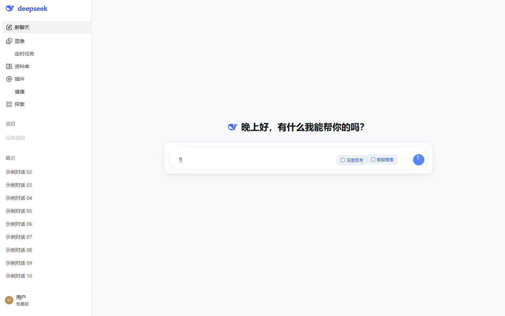

# ChatGPT → DeepSeek 外观脚本

> 仅替换页面外观，底层仍然是正常运行的 ChatGPT。

## 文件说明

- `chatgpt-deepseek-skin.user.js`：可直接安装到油猴的用户脚本
- `final_preview.png`：脱敏后的页面效果预览

## 安装方式

1. 打开油猴管理面板
2. 选择「添加新脚本」
3. 清空编辑器内容，粘贴 `chatgpt-deepseek-skin.user.js` 的全部内容
4. 保存脚本
5. 打开 <https://chatgpt.com/>，页面会自动套用 DeepSeek 风格外观

## 已实现的外观改动

- 侧边栏改为 DeepSeek 的浅灰底、260px 宽度
- 顶部 Logo 替换为 DeepSeek 鲸鱼标识和 `deepseek` 字样
- 首页问候语改为 DeepSeek 风格的时段问候，并带鲸鱼图标
- 输入框改为 DeepSeek 风格的大圆角框
- 增加「深度思考 / 智能搜索」视觉标签
- 发送按钮改为蓝色圆底白色上箭头
- 隐藏 GPT 的优惠入口、Chrome 扩展推广和首页快捷建议
- 页面标题与 favicon 同步改为 DeepSeek
- 地址栏附加对应的 DeepSeek 风格 URL，并随路由变化自动更新
- 支持亮色与暗色主题

## 地址栏 URL 说明

浏览器安全策略不允许油猴脚本把地址栏改成真实的其他域名，直接写入 `chat.deepseek.com` 会触发跨域错误。脚本因此保留 `chatgpt.com` 的真实路径，只在 URL 的 hash 中附加对应的 DeepSeek 地址：

- 首页：`https://chatgpt.com/#https://chat.deepseek.com/`
- 会话页：`https://chatgpt.com/c/<id>#https://chat.deepseek.com/a/chat/s/<id>`

脚本监听 `pushState`、`replaceState`、`popstate`、`hashchange`，并定时检查，GPT 路由每次变化都会自动刷新这段 DS 地址。真实站点始终是 `chatgpt.com`，刷新页面不会跳到 DeepSeek，复制出来的链接也仍然指向 ChatGPT。

## 功能保持说明

底层交互没有改动：

- 发送消息仍使用 GPT 原有发送逻辑
- 上传、新聊天、历史会话等按钮保留原功能
- 「深度思考」点击后仍进入 GPT 原有的思考模式设置
- 「智能搜索」为外观装饰，不拦截或改写任何 GPT 功能

## 稳定性处理

- 使用类名片段匹配，避免依赖完整的哈希类名
- 使用 MutationObserver 应对 React 重渲染
- 所有 DOM 改写均带幂等标记，重复执行不会重复插入节点
- 外观脚本内部异常被隔离，不会影响页面自身逻辑

## 适用范围

- 匹配站点：`https://chatgpt.com/*`
- 推荐浏览器：Chrome / Edge 等支持 Tampermonkey 的 Chromium 浏览器
